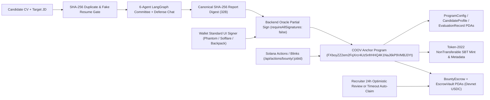

# COOV — AI Hiring Agents & Verified Credential Protocol on Solana

COOV (`coov_protocol`) is an adversarial multi-agent CV evaluation platform, **Token-2022 Non-Transferable Soulbound Credential (SBT)** issuer, and **anti-fraud Devnet USDC Bounty Escrow** built on Solana and Next.js 16.

Candidates are screened by a 6-agent LangGraph hiring committee plus a Fake Resume Detector Gate, earn cryptographically hashed on-chain `EvaluationRecord` proofs co-signed by an Oracle keypair, mint Soulbound Token-2022 credentials, and compete for USDC bounties locked in program-controlled Vault PDAs with a 24-hour optimistic recruiter review window.

---

## Solana Architecture & Multi-Language SDK Usage

- **Deployed Devnet Program ID:** [`FXboyZZ2em2FqXrcr4Uz5nfrHHQ4K1NaJ6kP9VMBJ3Yt`](https://explorer.solana.com/address/FXboyZZ2em2FqXrcr4Uz5nfrHHQ4K1NaJ6kP9VMBJ3Yt?cluster=devnet)
- **Devnet USDC SPL Mint:** [`4zMMC9srt5Ri5X14GAgXhaHii3GnPAEERYPJgZJDncDU`](https://explorer.solana.com/address/4zMMC9srt5Ri5X14GAgXhaHii3GnPAEERYPJgZJDncDU?cluster=devnet)
- **Token Extensions Program:** [`TokenzQdBNbLqP5VEhdkAS6EPFLC1PHnBqCXEpPxuEb`](https://explorer.solana.com/address/TokenzQdBNbLqP5VEhdkAS6EPFLC1PHnBqCXEpPxuEb?cluster=devnet) (SPL Token-2022 `NonTransferable` + `MetadataPointer` + on-chain TokenMetadata)

### End-to-End Protocol Flow



### On-Chain Account & PDA Map

| Account Struct | PDA Seeds | Responsibility |
| :--- | :--- | :--- |
| `ProgramConfig` | `[b"config"]` | Global admin, authorized `oracle_authority` pubkey, pause circuit-breaker |
| `CandidateProfile` | `[b"profile", candidate_pubkey]` | Aggregate evaluation counter, `highest_score`, verified skill tags, role title |
| `ReputationState` | `[b"reputation", candidate_pubkey]` | Reputation decay (`30d`), `verified_streak`, `total_earned_usdc`, `fraud_flags`, Zero-Stake Fast-Track unlock (`streak >= 2`) |
| `EvaluationRecord` | `[b"eval", candidate_pubkey, eval_id_16b]` | Immutable Proof PDA: initial & defended SHA-256 report hashes, 6 per-agent scores, SBT mint flag |
| `BountyEscrow` | `[b"escrow", job_id_16b]` | Recruiter address, USDC mint, `reward_per_winner`, `stake_bps` (default 10%), `slashed_pool_amount`, `min_streak`, `max_winners`, `min_score`, expiry |
| `ConvictionStake` | `[b"conviction_stake", escrow_pda, candidate_pubkey]` | Locks candidate's refundable USDC stake before review (`Pending` → `Approved`, `Slashed`, or `Refunded`), stores `referrer: Option<Pubkey>` and `is_zero_stake_vip` |
| `EscrowVault` | `[b"escrow_vault", escrow_pda]` | Program-owned SPL Token PDA holding bounty pool, pending stakes, and slashed spam yield |
| `BountyClaim` | `[b"claim", escrow_pda, candidate_pubkey]` | On-chain one-claim-per-candidate receipt linked to `EvaluationRecord` |

---

## Multi-Language SDK File Matrix

Note: TypeScript application modules live under root `lib/` and `app/` (mapped via `@/* -> ./*` in `tsconfig.json`).

### 1. Rust / Anchor On-Chain Program (`solana/`)

| File | Stack / SDK | Purpose |
| :--- | :--- | :--- |
| [solana/programs/coov_solana/src/lib.rs](solana/programs/coov_solana/src/lib.rs) | `anchor-lang`, `anchor-spl` (`token_2022`, `associated_token`) | Live Devnet Anchor program implementing `initialize_config`, `init_profile`, `record_evaluation`, `update_evaluation_after_defense`, `mint_credential` (Token-2022 NonTransferable SBT + inline TLV metadata), `create_bounty_escrow`, `claim_bounty`, and `withdraw_expired_escrow` |
| [solana/programs/coov_solana/Cargo.toml](solana/programs/coov_solana/Cargo.toml) | Cargo / Anchor 0.29 | Program manifest enabling `token_2022` and `associated_token` CPI features |
| [solana/Anchor.toml](solana/Anchor.toml) | Anchor CLI | Cluster configuration binding `[programs.devnet]` to `FXboyZZ2em2FqXrcr4Uz5nfrHHQ4K1NaJ6kP9VMBJ3Yt` |
| [solana/idl/coov_solana.json](solana/idl/coov_solana.json) | Anchor IDL JSON | Compiled IDL artifact for instructions, accounts, events, and custom error codes (`6000–6019`) |
| [solana/tests/coov_solana.ts](solana/tests/coov_solana.ts) | `@coral-xyz/anchor`, `@solana/web3.js`, `@solana/spl-token`, `vitest` | Anchor integration tests verifying PDA derivation, `BountyEscrow` / `ProgramConfig` instruction coding, Token-2022 Non-Transferable mint layout, Devnet USDC accounting, and live RPC checks |

### 2. TypeScript SDK, Wallet Standard & Solana Actions (`lib/solana/`, `components/`, `app/`)

| File | Stack / SDK | Purpose |
| :--- | :--- | :--- |
| [lib/solana/codec.ts](lib/solana/codec.ts) | `@solana/web3.js`, `@solana/spl-token` | Deterministic PDA derivations (`deriveConfigPda`, `deriveProfilePda`, `deriveEvaluationPda`, `deriveEscrowPda`, `deriveEscrowVaultPda`, `deriveClaimReceiptPda`), Anchor 8-byte discriminators, and Borsh instruction/account codecs |
| [lib/solana/anchor-client.ts](lib/solana/anchor-client.ts) | `@coral-xyz/anchor` (`Program`, `AnchorProvider`) | Legacy-to-v0.32 IDL adapter (`normalizeIdlForAnchor`), read-only `AnchorProvider`, and `program.account.*.fetchNullable` account deserialization over Helius / Devnet RPC |
| [lib/solana/config.ts](lib/solana/config.ts) | `@solana/web3.js` | Multi-endpoint RPC failover (`SOLANA_RPC_URL` / Helius -> Devnet), HTTP signature polling (`confirmSignatureViaPolling` for serverless runtimes), and Oracle keypair parser |
| [lib/solana/oracle.ts](lib/solana/oracle.ts) | `@solana/web3.js`, `@solana/spl-token` | Partial-signed (`requireAllSignatures: false`) co-signing flows for evaluation recording, defense upgrades, Token-2022 SBT minting, USDC escrow creation, candidate claim, and expired refund |
| [lib/solana/canonical-hash.ts](lib/solana/canonical-hash.ts) | Web Crypto SHA-256 | Canonical JSON serialization producing deterministic 32-byte report digests attested on-chain |
| [lib/solana/signature.ts](lib/solana/signature.ts) | Ed25519 / Web Crypto | Wallet ownership proof verification (`SignMessage`) before binding a wallet address to a user profile |
| [components/providers/solana-wallet-provider.tsx](components/providers/solana-wallet-provider.tsx) | `@wallet-standard/app`, `@solana/wallet-standard-features` | Framework-agnostic Wallet Standard provider supporting `standard:connect`, `solana:signMessage`, `solana:signTransaction`, and `solana:signAndSendTransaction` |
| [components/solana/solana-identity-card.tsx](components/solana/solana-identity-card.tsx) | React 19 + HTML5 Canvas | Portrait A4-proportioned On-Chain & SBT Identity Card with borderless mascot showcase and client-side high-DPI PNG exporter |
| [app/api/actions/bounty/[jobId]/route.ts](app/api/actions/bounty/[jobId]/route.ts) | `@solana/actions` (`createPostResponse`, `ACTIONS_CORS_HEADERS`) | Solana Actions / Blinks `GET` / `POST` / `OPTIONS` endpoint to inspect live escrow PDAs or generate `create_bounty_escrow` funding transactions |
| [app/actions.json/route.ts](app/actions.json/route.ts) | `@solana/actions` | Root Blinks rule discovery manifest mapping `/bounties/*` to `/api/actions/bounty/*` |
| `app/api/solana/**` | Next.js App Router + Drizzle (`Neon`) | Authenticated REST routes for wallet linking, admin `init-config`, SBT minting, bounty escrow submit/review/claim/refund, and RPC broadcast |

### 3. Python Independent Verification CLI (`solana/scripts/`)

| File | Stack / SDK | Purpose |
| :--- | :--- | :--- |
| [solana/scripts/verify_onchain.py](solana/scripts/verify_onchain.py) | `solders`, `solana` (`AsyncClient`), `base58`, `python-dotenv` | Independent CLI auditor that derives PDAs, fetches live Devnet account state, Borsh-decodes all 5 Anchor structs, validates Token-2022 Non-Transferable mint TLV extensions, and prints a structured terminal or `--json` audit report |
| [solana/scripts/requirements.txt](solana/scripts/requirements.txt) | `pip` | Python runtime dependencies (`solana>=0.35.0`, `solders>=0.21.0`) |

---

## Key Platform Capabilities

1. **Adversarial Multi-Agent Screening & Defense Chat:** 6 specialist AI agents (HR Recruiter, Technical Interviewer, ATS Scanner, Hiring Manager, Career Strategist, Red Flag Analyst) evaluate a CV against a target JD, followed by an interactive candidate defense workflow (`update_evaluation_after_defense`).
2. **Conviction Stake & Anti-Fraud Slashing Gate:**
   - **Mandatory USDC Stake (`submit_with_conviction_stake`):** Candidates lock a configurable percentage stake (default `10%` of reward per winner) in Devnet USDC before entering review.
   - **SHA-256 Duplicate & Fake Resume Detector Gate:** Duplicate or fabricated resumes trigger permanent restriction plus `slash_fraud_stake`, locking the scammer's stake into `slashed_pool_amount` (**Slashed Spam Yield**), permanently resetting their streak to `0`, and incrementing `fraud_flags`.
   - **Pro-Rata Spam Yield & Decentralized 90/10 Scout Split (`approve_and_payout`):** Recruiter approval (or 24h timeout auto-claim) transfers **90%** of `reward_per_winner` to the candidate + **10%** directly to a verified Scout referrer (if referred, blocking self-referrals), plus 100% stake refund + pro-rata share of `slashed_pool_amount` to the candidate's ATA.
3. **Reputation Decay (30d) & Streak Multiplier (`ReputationState` PDA):**
   - Qualifying evaluations (`composite_score >= 75`) and bounty wins increment `verified_streak` if within `30 days` (`2,592,000s`), or decay back to `1` if idle >30 days.
   - **Fast-Track Zero-Stake Perk:** Candidates maintaining `verified_streak >= 2`, `fraud_flags == 0`, and active 30d freshness waive Conviction Stake USDC deposits automatically (**0 USDC Stake VIP**).
   - Recruiter bounties can also gate entry via `min_streak` (`0`, `1+`, `2+`, etc.).
4. **24h Optimistic Recruiter Review & On-Chain USDC Settlement:**
   - Qualifying candidates (`score >= min_score`) lock a winner slot in `pending_review` for 24 hours.
   - Bounty creators inspect candidate CVs and 6-agent audits from the publisher review panel to approve payout (`approve_and_payout` / `claim_bounty`) or reject/flag and free the slot; after 24 hours without action, candidates can auto-claim on-chain.
5. **Verified Token-2022 Soulbound Credentials:** Candidates mint permanent, non-transferable Token-2022 NFTs storing role title, score tier, `EvaluationRecord` PDA hash, and evaluation UUID directly in on-chain TokenMetadata.

---

## Local Setup & Verification

### 1. Environment Configuration

Copy `.env.example` to `.env.local` and provide your Neon PostgreSQL URL, Gemini API key, Helius/Solana Devnet RPC, and funded Oracle keypair:

```bash
cp .env.example .env.local
npm install
```

Key Solana variables in `.env.local`:

```env
SOLANA_CLUSTER=devnet
SOLANA_RPC_URL=https://api.devnet.solana.com
NEXT_PUBLIC_SOLANA_RPC_URL=https://api.devnet.solana.com
NEXT_PUBLIC_SOLANA_CLUSTER=devnet
NEXT_PUBLIC_SOLANA_PROGRAM_ID=FXboyZZ2em2FqXrcr4Uz5nfrHHQ4K1NaJ6kP9VMBJ3Yt
NEXT_PUBLIC_SOLANA_USDC_MINT=4zMMC9srt5Ri5X14GAgXhaHii3GnPAEERYPJgZJDncDU
COOV_ORACLE_PRIVATE_KEY=[...]
```

### 2. Run Database Migrations & Next.js Dev Server

```bash
npm run db:push
npm run dev
```

### 3. Run Unit & Anchor Integration Tests

```bash
# Typecheck, Vitest unit suite, and production build
npx next typegen && npm run typecheck && npm test && npm run build:next

# Run Anchor TypeScript integration & Devnet checks
npx vitest run solana/tests/coov_solana.ts
```

### 4. Inspect Solana Actions / Blinks Locally

```bash
# Actions discovery rules
curl http://localhost:3000/actions.json

# Inspect or generate a funding transaction for any Bounty job UUID
curl http://localhost:3000/api/actions/bounty/<JOB_UUID>
```

### 5. Run Independent Python Devnet Audit CLI

```bash
pip install -r solana/scripts/requirements.txt

# Audit deployed program, ProgramConfig PDA, and Devnet USDC Mint
python solana/scripts/verify_onchain.py

# Full audit for a candidate wallet, evaluation proof, bounty escrow, and SBT mint
python solana/scripts/verify_onchain.py \
  --wallet <CANDIDATE_PUBKEY> \
  --eval-id <EVALUATION_UUID> \
  --job-id <JOB_UUID> \
  --mint <TOKEN_2022_SBT_MINT>
```
